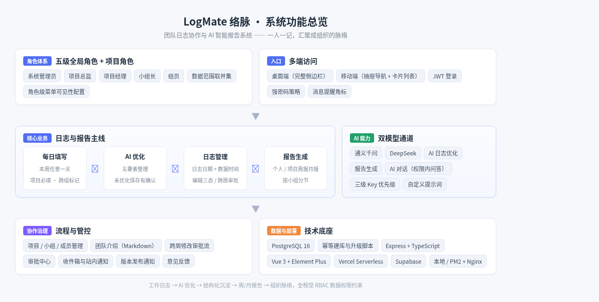
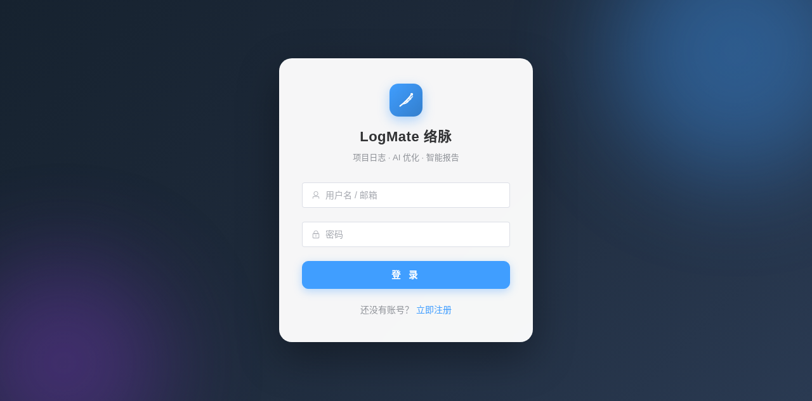
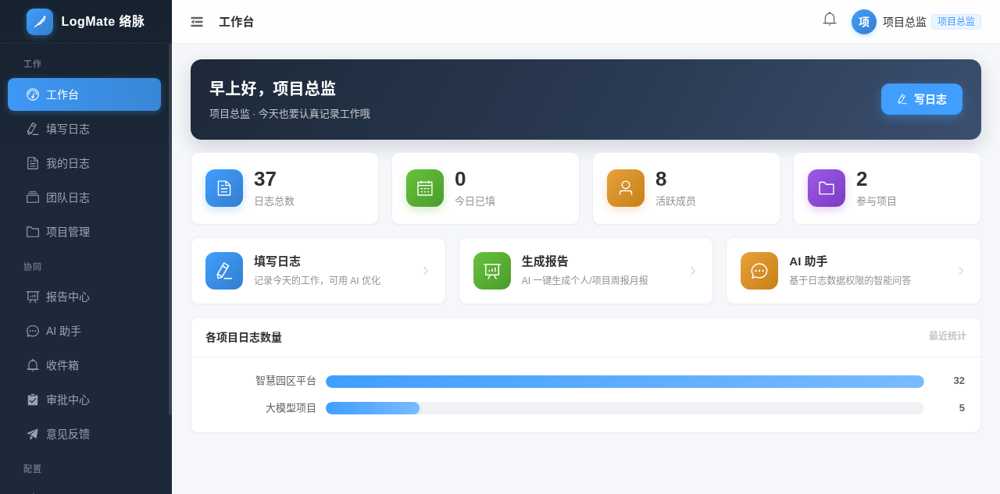
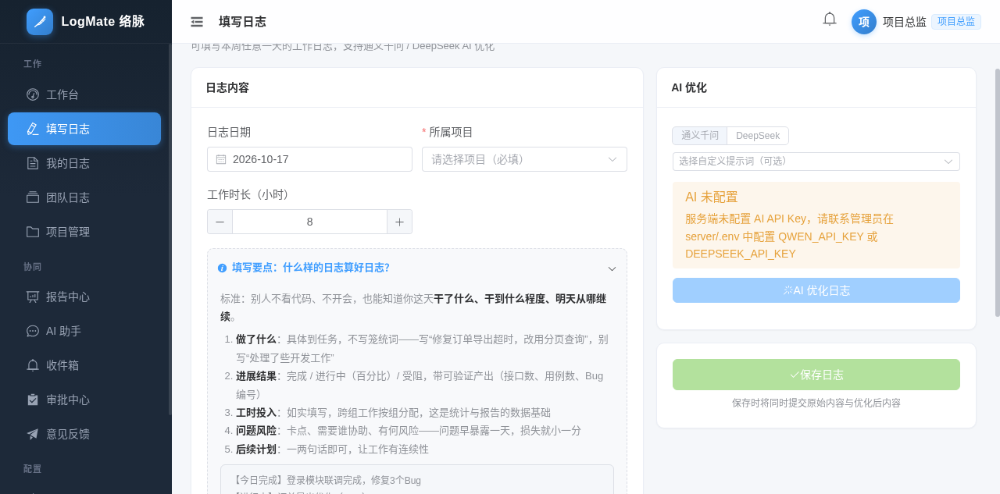
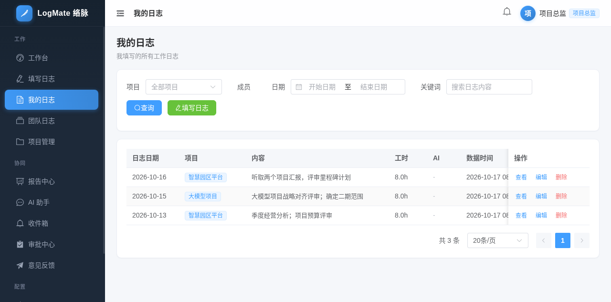
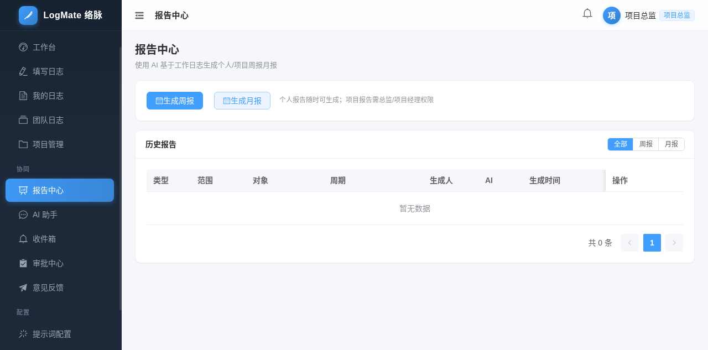
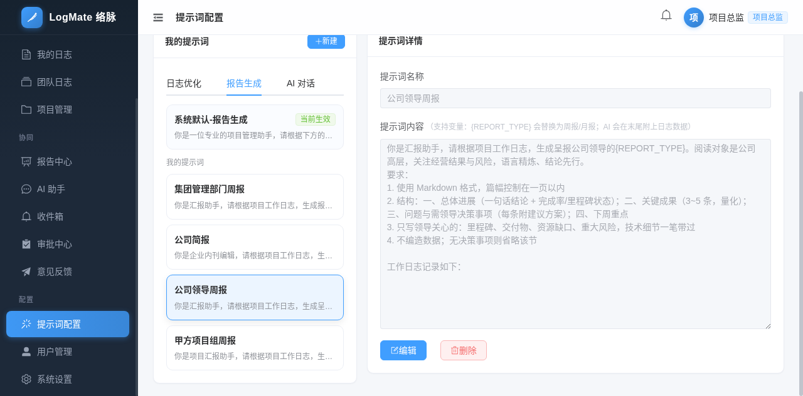
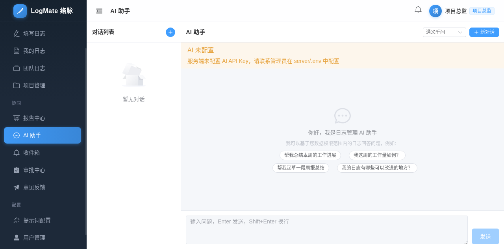
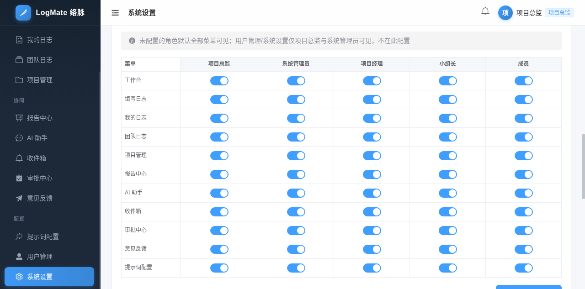

# MateLog 脉络

> 团队日志协作与 AI 智能报告系统——一人一记，汇聚成组织的脉络。

MateLog 脉络是一个面向项目团队的日志管理系统，支持项目管理、每日工作日志（AI 优化：通义千问 / DeepSeek）、个人/项目周报月报生成、自定义提示词与 AI 对话、跨周修改审批流、收件箱消息中心，并实现了五级角色（系统管理员/项目总监/项目经理/小组长/组员）的数据权限控制与角色级菜单可见性配置。当前版本 v1.2.1。

> 在线 Demo：https://pm-tools-log.vercel.app ｜ 源码：https://github.com/smarkfire/PM-Tools-Log

## 系统功能图



## 界面截图

### 登录页

MateLog 脉络品牌入口，支持注册 / 登录（JWT 鉴权，强密码策略）。



### 工作台

按角色统计的工作量总览与快捷入口。



### 填写日志

支持本周任意一天填写、项目必填、跨组协作标记（一篇日志可标记多个小组并分配各组工时）。内置"填写要点"引导（好日志五要素与模板），右侧可一键 AI 优化（通义千问 / DeepSeek），未优化直接保存时会弹窗确认。



### 我的日志

按"日志日期 + 数据时间"展示，本周日志直接编辑；跨周日志按状态显示"编辑 / 审批中 / 申请编辑"三态，历史修改全程审批留痕。



### 报告中心

AI 基于工作日志自动生成个人 / 项目周报、月报，支持自定义日期范围、"按小组分组"模式（各组工作分节、各组工时汇总），历史报告可管理查看。



### 提示词配置

用户可自定义三类提示词（日志优化 / 报告生成 / AI 对话）并设为默认；内置多组场景提示词：需求分析 / 数据工程 / 智能体开发日志优化，以及公司领导周报、甲方项目组周报、集团管理部门周报、公司简报四种报告口径（同一份日志，四种输出）。



### AI 助手

多会话管理，AI 基于用户数据权限范围内的日志回答问题，支持通义千问 / DeepSeek 模型切换。



### 系统设置（角色菜单可见性）

系统管理员可按角色（系统管理员 / 项目总监 / 项目经理 / 小组长 / 组员）配置各功能菜单的可见性，与全局菜单开关双重生效。



## 技术栈

- **前端**：Vue 3 + TypeScript + Vite + Element Plus + Pinia + Vue Router（完整响应式，适配桌面/平板/手机）
- **后端**：Node.js + Express + TypeScript + JWT
- **数据库**：PostgreSQL 16
- **AI**：通义千问（DashScope OpenAI 兼容接口）/ DeepSeek（OpenAI 兼容接口）

## 功能清单

| 模块 | 功能 |
|------|------|
| 用户 | 注册、登录（JWT）、修改密码（强制强密码校验）、个人设置；首个注册用户自动成为项目总监 |
| 角色 | 五级全局角色：系统管理员 / 项目总监 / 项目经理 / 小组长 / 组员；管理员可按角色配置菜单可见性（与全局菜单开关双重生效） |
| 项目 | 项目 CRUD、团队介绍（Markdown 可编辑）、项目成员管理（项目经理/小组长/组员）、项目小组与组长设置 |
| 日志 | 每日填写（本周任意一天，一天一篇，重复提交自动更新）、所属项目必填、工时记录、跨组协作标记（一篇日志可标记多个小组并分配各组工时）、"填写要点"五要素引导、按项目/日期/关键词筛选 |
| AI 优化 | 使用千问或 DeepSeek 将流水账日志优化为结构化、易读、体现工作量的专业日志；未优化直接保存时弹窗确认 |
| 审批 | 跨周日志/报告修改需上级审批（通过后仅可修改一次）；本周内日志自由编辑；列表按状态显示"编辑 / 审批中 / 申请编辑" |
| 报告 | 个人周报/月报、项目周报/月报（AI 生成，支持自定义日期范围与"按小组分组"模式：各组工作分节展示、各组投入工时汇总、无日志小组提醒），历史报告管理与查看 |
| 提示词 | 用户可自定义三类提示词（日志优化/报告生成/AI 对话）并设为默认；内置需求分析/数据工程/智能体开发日志优化与公司领导/甲方项目组/集团管理部门/公司简报四种周报口径 |
| AI 对话 | 多会话管理，AI 可基于用户数据权限范围内的日志回答问题 |
| 消息 | 收件箱统一管理站内消息（版本更新/审批结果/反馈回复），顶栏铃铛实时提醒未读数 |
| 用户管理 | 系统管理员/项目总监管理所有用户的全局角色 |

## 数据权限模型（RBAC）

| 角色 | 范围 | 数据权限 |
|------|------|----------|
| 系统管理员（admin，全局角色） | 全系统 | 与项目总监同级：查看所有数据、用户管理、系统设置，跨周修改免审批 |
| 项目总监（director，全局角色） | 全系统 | 查看所有项目、所有成员的日志与报告；跨周修改免审批 |
| 项目经理（manager，项目角色） | 所管辖项目 | 查看项目内全部成员的日志、生成项目报告、管理成员与小组 |
| 小组长（leader，项目角色） | 所在小组 | 查看本小组成员的日志 |
| 组员（member） | 本人 | 仅查看自己的日志 |

> 一个用户可在不同项目中承担不同角色，数据范围取并集；AI 对话的日志上下文同样受此权限约束。

## 部署方式一：本地部署（Linux + PostgreSQL）

适合自建服务器、内网部署、二次开发调试。

### 1. 环境准备

| 依赖 | 最低版本 | 说明 |
|------|----------|------|
| Node.js | >= 18 | 前后端共用 |
| PostgreSQL | >= 14 | 数据库 |
| npm | >= 9 | 随 Node.js 安装 |

#### 安装 PostgreSQL（以 Ubuntu/Debian 为例）

```bash
# 安装 PostgreSQL 16
sudo sh -c 'echo "deb https://apt.postgresql.org/pub/repos/apt $(lsb_release -cs)-pgdg main" > /etc/apt/sources.list.d/pgdg.list'
curl -fsSL https://www.postgresql.org/media/keys/ACCC4CF8.asc | sudo gpg --dearmor -o /etc/apt/trusted.gpg.d/postgresql.gpg
sudo apt update
sudo apt install -y postgresql-16

# 启动服务
sudo systemctl enable postgresql
sudo systemctl start postgresql
```

#### 安装 Node.js（推荐用 nvm）

```bash
curl -o- https://raw.githubusercontent.com/nvm-sh/nvm/v0.39.7/install.sh | bash
source ~/.bashrc
nvm install 20
node -v   # 确认 >= 18
```

### 2. 一键启动（推荐）

```bash
git clone https://github.com/smarkfire/PM-Tools-Log.git
cd PM-Tools-Log
chmod +x start.sh
./start.sh dev
```

脚本会自动完成全部流程：

```
启动 PostgreSQL → 创建数据库/用户 → 后端 npm install → 初始化表结构+演示数据 → 启动后端(:3000) → 前端 npm install → 启动前端(:5173)
```

启动后访问 http://localhost:5173 即可使用。

### 3. 手动分步部署

如果不使用一键脚本，可按以下步骤操作：

#### 3.1 创建数据库用户与库

```bash
sudo -u postgres psql -c "CREATE USER logadmin WITH PASSWORD 'LogAdmin@2026!Db' SUPERUSER;"
sudo -u postgres psql -c "CREATE DATABASE logdb OWNER logadmin;"
```

#### 3.2 配置后端环境变量

```bash
cd server
cp .env.example .env   # 如果没有 .env.example，手动创建
```

编辑 `server/.env`：

```env
# 数据库（本地直连）
DB_HOST=localhost
DB_PORT=5432
DB_USER=logadmin
DB_PASSWORD=LogAdmin@2026!Db
DB_NAME=logdb

# JWT 密钥（随机长字符串）
JWT_SECRET=your-random-jwt-secret-here

# AI 配置（可选，也可部署后在系统设置中配置）
QWEN_API_KEY=
DEEPSEEK_API_KEY=
```

#### 3.3 安装依赖并初始化数据库

```bash
cd server
npm install

# 初始化数据库（建表 + 演示数据，幂等可重复执行）
npm run init-db
```

> 也可以用 SQL 脚本手动建库：
> ```bash
> psql -h localhost -U logadmin -d logdb -f server/sql/01_schema.sql
> psql -h localhost -U logadmin -d logdb -f server/sql/02_seed_demo.sql
> ```
> 两个脚本均可重复执行（自动跳过已存在的数据）。
>
> **从 v1.0.0 旧版本升级**：已有 v1.0.0 部署的数据库请先执行升级脚本（无需重跑建库脚本）：
> ```bash
> psql -h localhost -U logadmin -d logdb -f server/sql/upgrade_v1.0_to_v1.1.sql
> ```
> **从 v1.1.x 升级到 v1.2.x**：无表结构变更；如需为已有数据库补充 7 组场景提示词（演示账号），执行：
> ```bash
> psql -h localhost -U logadmin -d logdb -f server/sql/upgrade_v1.1_to_v1.2_prompts.sql
> ```
> 各版本功能变化见 [docs/version-history.md](docs/version-history.md)。

#### 3.4 启动后端

```bash
cd server
npm run dev          # 开发模式，热重载，监听 http://localhost:3000
# 或
npm run build && npm start   # 生产模式
```

#### 3.5 启动前端

```bash
cd web
npm install
npm run dev          # 开发模式，监听 http://localhost:5173
# 或
npm run build && npm run preview   # 生产预览
```

### 4. AI 配置（三种方式，按优先级）

**优先级：用户自己的 Key > 系统配置 Key（管理员界面配置）> 服务器 .env**

| 配置方式 | 操作位置 | 适用场景 |
|---------|---------|---------|
| 用户个人 Key | 【个人设置 → AI 服务配置】 | 每个用户使用自己的 Key |
| 系统默认 Key | 【系统设置 → 系统 AI 服务】（仅项目总监可见） | 为所有用户统一提供 Key |
| .env 环境变量 | 编辑 `server/.env` 后重启 | 部署时的兜底配置 |

`.env` 示例：

```env
# 通义千问（DashScope）
QWEN_API_KEY=sk-xxx
QWEN_MODEL=qwen-plus

# DeepSeek
DEEPSEEK_API_KEY=sk-xxx
DEEPSEEK_MODEL=deepseek-chat
```

管理员还可在【系统设置】中控制功能开放范围：

- **功能菜单开关**：控制各功能菜单是否对用户开放（如关闭"AI 助手"菜单）
- **角色菜单可见性**：按角色（系统管理员/项目总监/项目经理/小组长/组员）配置菜单开关矩阵，与全局开关双重生效（两者都开启才可见）
- **发布新版本**：发布版本更新说明，自动向全体用户收件箱推送通知

### 5. 生产环境部署（PM2 + Nginx）

```bash
# 全局安装 PM2
npm install -g pm2

# 构建并启动后端
cd server && npm install && npm run build
pm2 start dist/index.js --name log-server
pm2 save

# 构建前端
cd web && npm install && npm run build
# 将 dist/ 部署到 Nginx 静态目录
```

Nginx 配置示例：

```nginx
server {
    listen 80;
    server_name your-domain.com;

    # 前端静态资源
    location / {
        root /path/to/web/dist;
        try_files $uri $uri/ /index.html;
    }

    # 后端 API 反向代理
    location /api/ {
        proxy_pass http://127.0.0.1:3000;
        proxy_set_header Host $host;
        proxy_set_header X-Real-IP $remote_addr;
    }
}
```

### 6. 体验流程

1. 打开 http://localhost:5173 注册（首个用户为项目总监）
2. 总监在【用户管理】中将某用户全局角色设为"项目经理"
3. 项目经理创建项目 → 添加成员 → 创建小组并指定组长
4. 成员每日填写日志，可一键 AI 优化后保存
5. 个人在【报告中心】生成自己的周报/月报；项目经理/总监生成项目周报/月报
6. 【AI 助手】中基于自己权限范围内的日志数据智能问答

## 部署方式二：Vercel 部署（Supabase 数据库）

适合零运维、自动扩缩容、push 即部署的场景。本项目已适配 Vercel Serverless 部署：前端静态资源 + 后端 Express 单函数（`api/index.ts`），数据库连接 Supabase。

### 1. Supabase 数据库准备

> ⚠️ **重要**：Supabase 直连地址 `db.xxx.supabase.co` 仅支持 IPv6，而 Vercel 函数默认只支持 IPv4 出站，**必须使用 Supabase 的连接池（Pooler）地址**。在 Supabase 控制台点击「Connect → Connection Pooling」即可看到，形如：

```
postgresql://postgres.<项目ref>:<密码>@aws-0-<区域>.pooler.supabase.com:5432/postgres
```

### 2. Vercel 项目配置

导入 GitHub 仓库创建项目（Root Directory 保持仓库根目录），在 **Settings → Environment Variables** 配置：

| 环境变量 | 说明 |
|----------|------|
| `DATABASE_URL` | 上面的 Supabase Pooler 连接串（自动启用 SSL） |
| `JWT_SECRET` | JWT 签名密钥（随机长字符串） |
| `SETUP_KEY` | 远程初始化数据库的密钥（自定义随机字符串） |
| `AI_TIMEOUT_MS` | AI 请求超时，建议 `55000`（需小于函数 maxDuration 60s） |
| `QWEN_API_KEY` / `DEEPSEEK_API_KEY` | 可选，系统默认 AI Key（也可部署后在系统设置中配置） |

### 3. 初始化数据库（幂等，部署完成后执行一次）

```bash
curl -X POST https://<你的域名>/api/setup -H "X-Setup-Key: <你的SETUP_KEY>"
```

成功返回：`数据库初始化完成（表结构与种子数据已就绪）`。之后即可用演示账号登录使用。

### 4. 架构说明

- `api/index.ts`：Vercel Serverless 入口，导出 Express 应用
- `vercel.json`：`/api/*` 路由到后端函数，其余路径回退到 `index.html`（SPA）
- `server/src/config/db.ts`：Serverless 小连接池 + 冻结连接自动重试

## 测试账号（演示数据）

| 账号 | 密码 | 角色 | 内置提示词（提示词配置页可见） |
|------|------|------|------|
| director1 | PmLog@2026!Secure | 项目总监 | 报告生成：公司领导周报 / 甲方项目组周报 / 集团管理部门周报 / 公司简报 |
| pm1 | PmLog@2026!Secure | 项目经理（智慧园区平台） | — |
| pm2 | PmLog@2026!Secure | 项目经理（大模型项目） | — |
| leader1 | PmLog@2026!Secure | 小组长（前端组） | — |
| leader2 | PmLog@2026!Secure | 小组长（后端组） | — |
| member1 | PmLog@2026!Secure | 组员（前端组） | 日志优化：技术风日志优化（默认）、需求分析日志优化 |
| member2 | PmLog@2026!Secure | 组员（前端组） | 日志优化：数据工程日志优化 |
| member3 | PmLog@2026!Secure | 组员（后端组） | 日志优化：智能体开发日志优化 |

运行 `server/test-e2e.sh` 可执行完整的端到端业务与数据权限测试（33 项断言）。

## 项目结构

```
├── start.sh                  # 一键启动脚本
├── api/
│   └── index.ts              # Vercel Serverless 入口（导出 Express 应用）
├── vercel.json               # Vercel 部署配置（API 路由 + SPA 回退）
├── package.json              # 根依赖（供 api/ 函数构建）
├── server/                   # 后端
│   ├── src/
│   │   ├── app.ts            # Express 应用（与监听分离，供 Serverless 复用）
│   │   ├── config/           # 数据库连接池、环境变量
│   │   ├── middleware/       # JWT 认证、asyncHandler、错误处理
│   │   ├── controllers/      # 认证/用户/项目/日志/报告/提示词/AI对话
│   │   ├── services/         # 权限服务（RBAC 数据范围）、AI 服务
│   │   ├── routes/           # 路由注册
│   │   ├── scripts/initDb.ts # 建表脚本（幂等，支持远程 /api/setup 触发）
│   │   └── types/            # 类型定义
│   └── test-e2e.sh           # 端到端测试脚本
└── web/                      # 前端
    └── src/
        ├── api/              # Axios 封装与接口
        ├── stores/           # Pinia（用户状态、响应式断点）
        ├── router/           # 路由与权限守卫
        ├── views/            # 页面（登录/工作台/日志/项目/报告/AI对话/设置）
        └── styles/           # 全局样式（含响应式断点）
```

## 响应式设计说明

- 断点：768px 以下为移动端布局
- 桌面端：固定侧边栏（可折叠）+ 顶部栏
- 移动端：抽屉式侧边栏 + 精简表格（列表卡片化）+ 全宽表单 + 精简分页器
- 栅格：统计卡片/项目卡片使用 Element Plus 响应式栅格（xs/sm/md/lg）

## 版权与授权协议

本项目采用 **非商业使用授权模式**（参照 [PolyForm Noncommercial License 1.0.0](https://polyformproject.org/licenses/noncommercial/1.0.0/) 精神，完整条款见仓库根目录 [LICENSE](LICENSE) 文件）：

### ✅ 允许（免费）

- 个人学习、研究、教学使用
- 阅读和分析源码，用于技术学习
- 修改后自用于非商业目的
- 在非商业项目中部署使用

### ❌ 需要商业授权（收费）

- 将本系统（含修改版本）用于企业内部商业运营
- 基于本系统二次开发后销售、SaaS 化运营
- 其他任何以营利为目的的使用

### 商业授权联系

如需商业授权，请联系作者：

- **微信：aichuandao**

---

> 注意：本协议为“源码可用（Source Available）”授权，不属于 OSI 定义的严格开源协议。个人与非商业使用免费，商业使用需获得作者书面授权许可。
